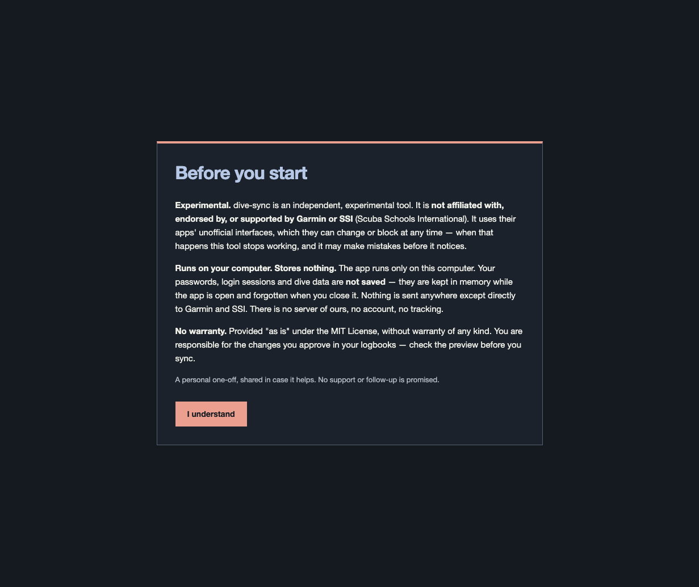
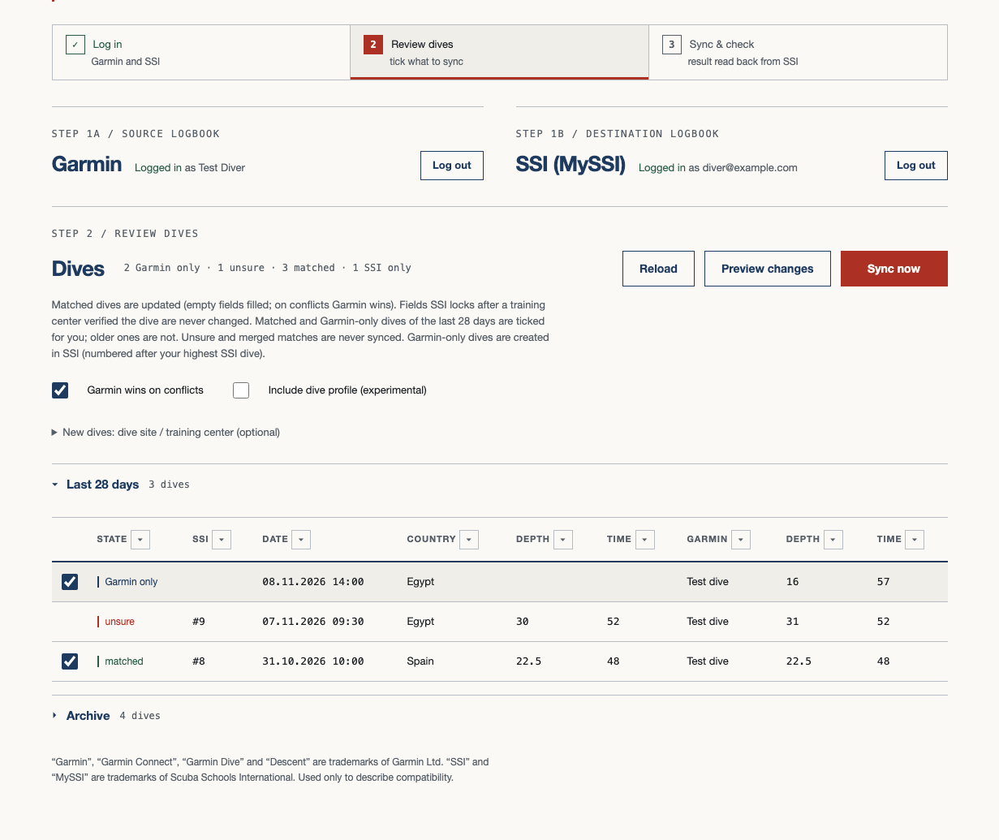
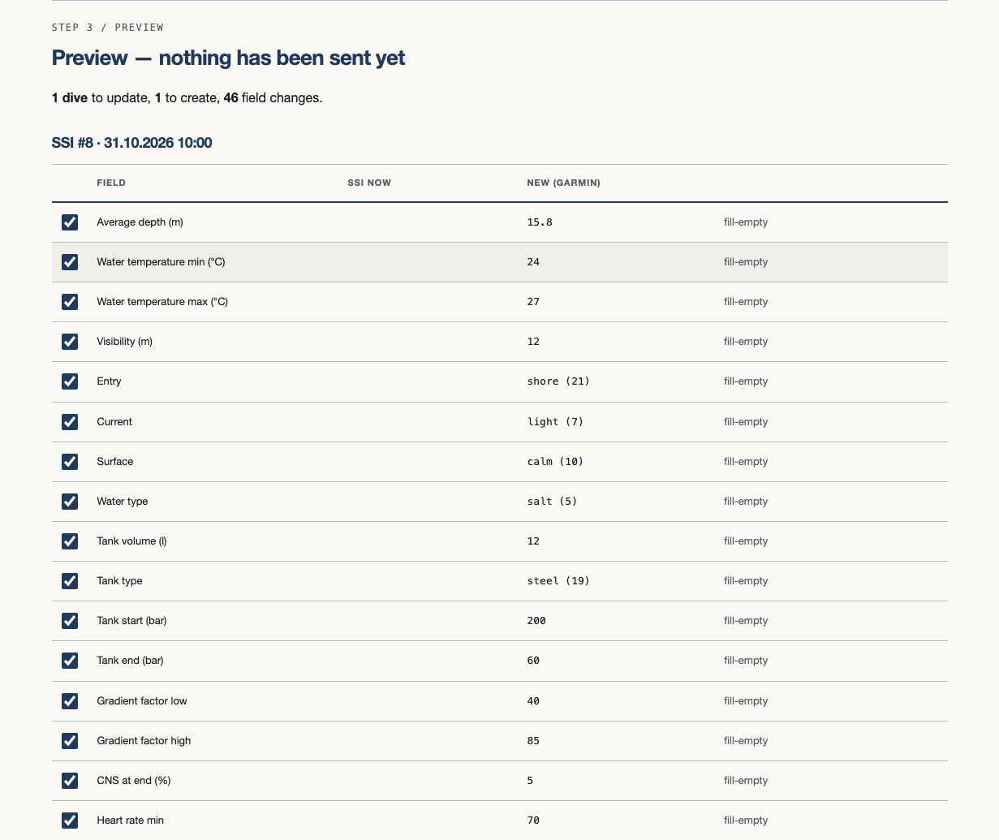
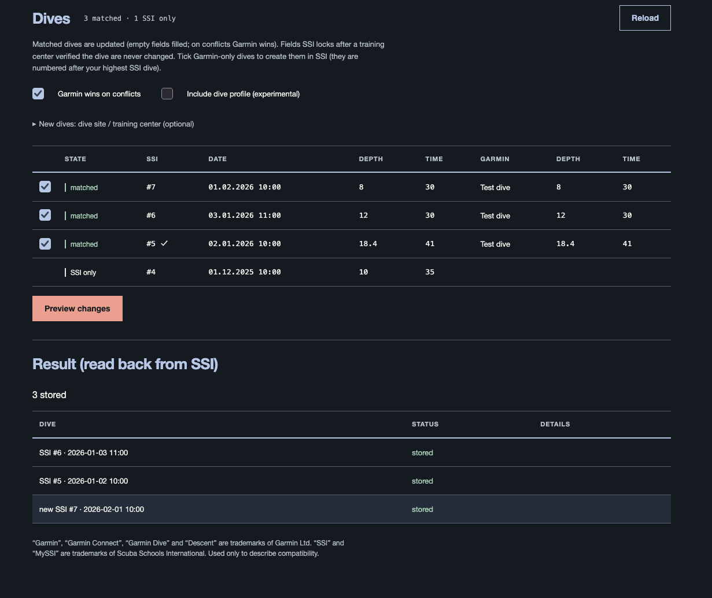
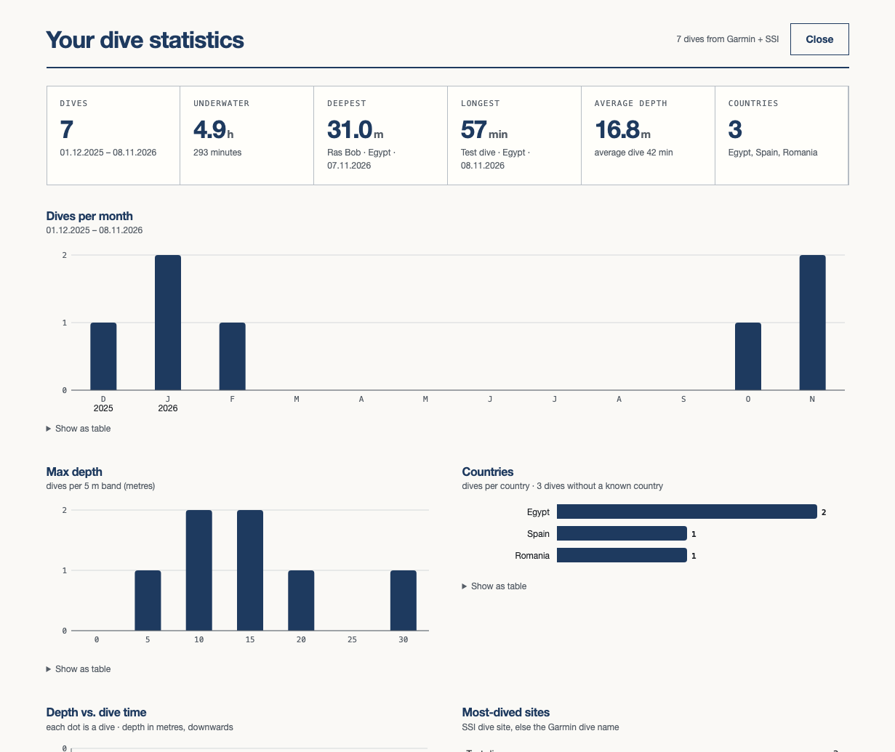

# dive-sync

Experimental local tool to sync dive logs between Garmin (Connect/Dive) and the SSI logbook.
Runs only on your computer, stores nothing, not endorsed by Garmin or SSI. Use it in the
browser, from the command line, or with a coding agent (Claude Code, Codex, OpenCode) via the
included skill.

> **Experimental.** dive-sync is an independent, experimental tool. It is **not affiliated with,
> endorsed by, or supported by Garmin or SSI** (Scuba Schools International). It uses their apps'
> unofficial interfaces, which they can change or block at any time — when that happens this tool
> stops working, and it may make mistakes before it notices.
>
> **Runs on your computer. Stores nothing.** Your passwords, login sessions and dive data are not
> saved — they are kept in memory while the app is open and forgotten when you close it. Nothing is
> sent anywhere except directly to Garmin and SSI. There is no server of ours, no account, no tracking.
>
> **No warranty.** Provided "as is" under the [MIT License](LICENSE), without warranty of any kind.
> You are responsible for the changes you approve in your logbooks — check the preview before you sync.

## Screenshots

Taken from the built-in demo (`python -m tests.demo_server`) with made-up dives — no real account.

| | |
|---|---|
|  |  |
|  |  |
|  | |

## Maintenance — please read

This is a personal one-off I built to solve my own problem: getting my Garmin Descent dives,
including tank pressures, into my SSI logbook. I'm sharing it in case it helps someone else, and you
are welcome to use it and serve yourself. **I will probably not follow up on it, and I will not
troubleshoot setups that don't work on your computer.** The code comes as it is. Forks are welcome.

## Known to work with (verified 09.11.2026)

| Interface | Version |
|---|---|
| SSI app API (MySSI) | `https://api.divessi.com/app/a21.php` as used by the MySSI app **5.0.46** |
| Garmin Dive API | `https://connectapi.garmin.com/diving/v1` (dive detail, tank sensors, record series) |
| Garmin Connect API | activity list / activity service (Garmin Connect web/app back end) |
| `garminconnect` Python library | **0.3.20** (pinned) |
| Python | 3.12 – 3.13 (tests also pass on 3.15) |
| Watch / tank transmitters | **Tested only with a Garmin Descent Mk3i** and Descent T2 transmitters |

**Other Garmin dive computers:** it may work with any Garmin watch that logs dives to Garmin Connect
(other Descent models, or other Garmin watches with a dive mode), because it reads the dives from Garmin
Connect and Garmin Dive, not from the watch itself. Only the Descent Mk3i has been tested; fields a
watch does not record (for example tank pressure without transmitters) simply stay empty.

`dive-sync --version` prints the same table. If a vendor changes these interfaces, dive-sync
refuses to write and tells you (exit code 4) — it does not guess.

## Install

**Easiest — double-click.** Download `dive-sync-launchers.zip` from the
[Releases page](https://github.com/no84by/dive-sync/releases), unzip it and double-click
`Start dive-sync (Mac).command`, `Start dive-sync (Windows).bat` or run `start-dive-sync-linux.sh`.
The launcher finds Python 3.12 or newer (and offers the official python.org installer if it is
missing), then `launch.py` installs the **latest dive-sync release from GitHub** with its
requirements into a private folder and starts it; `launch.py` also updates itself from that release. Every start checks for a newer release; without
internet it starts the version you have. The zip carries no copy of dive-sync itself. `READ ME
FIRST.txt` in the zip explains the macOS/Windows "unidentified developer" warnings and how to
uninstall (`python3 launch.py --uninstall`).

**With pipx:**

```bash
pipx install git+https://github.com/no84by/dive-sync      # latest from the repository
# or download the .whl from the Releases page:  pipx install ./dive_sync-0.2.2-py3-none-any.whl
dive-sync                                                  # opens the browser
```

## Three ways to use it

1. **Browser.** Run `dive-sync`. The page opens on `http://127.0.0.1:<random port>` and walks you
   through three steps (**? Help / tour** explains every part of the page):
   1. **Log in** to Garmin and SSI (Garmin may ask for its e-mail/authenticator code).
   2. **Review dives.** Your dives are in two lists, newest first: **Last 28 days** (open; matched and
      Garmin-only dives ticked for you) and **Archive** (folded, not ticked). Unsure and merged
      matches are never synced. Every column sorts on a click and has an Excel-style
      filter: Date by year or month, numbers by a from–to range, State / Country / Garmin name by
      ticking values. Dives hidden by a filter are never synced, even if ticked.
   3. **Sync & check.** **Preview changes** shows every field old → new; untick anything you don't
      want, then **Sync these changes** (changing ticks or filters afterwards discards the preview).
      **Sync now** does the same for the ticked dives in one click, without the preview. The result
      is read back from SSI and shows what was stored and what SSI dropped.

   **Stats** shows your totals, deepest and longest dive, dives per month, depth bands, countries,
   depth vs. time and most-dived sites; every chart can also be shown as a table. The **Country**
   column comes from SSI's public dive-site catalogue (by the dive's SSI site, or the nearest site to
   the Garmin GPS start point), which loads in the background for about a minute after login.
2. **Command line.** The same app, scripted:

   ```bash
   dive-sync start --agent            # background app; prints {"url": ...}; log in on that page
   export DIVE_SYNC_URL='<url from above>'
   dive-sync status
   dive-sync dives                    # matched / merged / Garmin-only / SSI-only
   dive-sync plan                     # preview — sends nothing
   dive-sync apply --plan <id> --confirm
   dive-sync open                     # closed the tab? opens the page again (new single-use link)
   dive-sync stop                     # logs out of both and forgets everything
   ```

3. **With a coding agent** (Claude Code, Codex, OpenCode or any agent that can run shell commands).
   Open this repository in the agent and say *"sync my dives"*. The agent loads the included skill,
   starts the app, asks **you** to log in on the page, shows you the plan as a table, and applies
   only after you say yes. The agent never sees or types your passwords or codes.
   See [`agents/README.md`](agents/README.md) to use the skill outside this folder
   (`dive-sync agents install --global`).

## What it syncs (Garmin → SSI)

For dives that exist in both logbooks (matched by day, depth and duration — clocks may differ by
whole hours), dive-sync fills empty SSI fields and, on conflicts, **Garmin wins** (it measured; you
typed). You can switch that off (`--keep-ssi` / the checkbox).

Average depth · water temperature min/max · visibility · entry (shore/boat) · current · surface ·
water type · pool · tank volume and type · tank start/end pressure (first transmitter) · nitrox ·
gradient factors · CNS · heart rate min/avg/max · comment (only when empty; Garmin notes and any
further transmitters, e.g. the second sidemount tank) · dive profile (**experimental**, opt-in).

Never changed:

- **Fields SSI locks after a training center verified a dive** — date/time, number, max depth, dive
  time, dive type, purpose and gear configuration. Changing them would remove the verification.
  They are shown in the preview with a lock.
- Tank readings below 10 bar (a transmitter dropout, not a real pressure).
- Merged sessions (one SSI dive logged for several Garmin dives) and unsure matches — reported, not guessed.

New SSI dives are created only for Garmin-only dives you tick, numbered after your highest SSI dive.
Linking a training center is opt-in and sends that center a verification request.
SSI → Garmin is not in v1.

## CLI reference

Every command accepts `--json`. The app URL comes from `--url` or `DIVE_SYNC_URL`.

| Exit code | Meaning |
|---|---|
| 0 | ok |
| 1 | error |
| 2 | usage |
| 3 | not logged in (`dives`, `plan`, `apply`; `status` always exits 0 and reports each login) |
| 4 | a vendor interface changed — stop, don't retry |
| 5 | refused (no `--confirm`, plan already used or expired) |
| 6 | the app is not running |
| 7 | login failed |
| 8 | network error |

`dive-sync open --json` prints `{"opened": true|false, "page": "<single-use link>"}` (`opened` is
false with `--no-browser`).

A plan can be applied **once** (SSI has no delete, so a second submit could create duplicate dives).
Plans expire after 30 minutes and when the app stops. The app stops after 30 minutes without use.

## Privacy and security

See [SECURITY.md](SECURITY.md). In short: bound to `127.0.0.1`, random port, a random per-run key
in the URL, no CORS, no files written, no telemetry, no update checks.

## Trademarks

"Garmin", "Garmin Connect", "Garmin Dive" and "Descent" are trademarks of Garmin Ltd. or its
subsidiaries. "SSI" and "MySSI" are trademarks of Scuba Schools International. They are used here
only to describe compatibility; no logos are used.

## Development

```bash
python3.13 -m venv .venv && .venv/bin/pip install -e '.[dev]'
.venv/bin/pytest && .venv/bin/ruff check src tests
```

Design: [`docs/spec.md`](docs/spec.md). Notes for agents editing the code: [`AGENTS.md`](AGENTS.md).
Tests use synthetic data only — never commit real dive logs.
